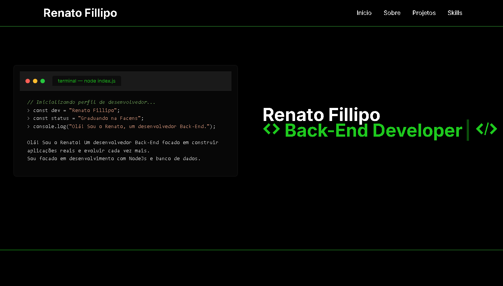

# 💻 Meu Portfólio Pessoal

  

Este é o repositório do meu portfólio profissional. Um site responsivo, limpo e otimizado para apresentar meus projetos e habilidades como desenvolvedor Back-End.

  
  
  

---

## 🚀 Sobre o Projeto

O objetivo deste projeto foi criar uma interface que reflita minha identidade como desenvolvedor. Utilizei uma estética baseada em janelas de terminal e editores de código para destacar meu foco em desenvolvimento de software e sistemas.

### 🛠️ Funcionalidades
- **Interface Responsiva:** Adaptada para dispositivos móveis, tablets e desktop.
- **Efeito de Digitação:** Animação dinâmica no título para atrair a atenção do usuário.
- **Janelas de Código:** Componentes customizados em CSS que simulam um ambiente de desenvolvimento (IDE).
- **Smooth Scroll:** Navegação suave entre as seções da página.
- **Modo Dark Nativo:** Design focado em baixo contraste e legibilidade.

---

## 🏗️ Estrutura do Código

O projeto foi organizado seguindo boas práticas de "Clean CSS" e semântica HTML:

- **HTML5 Semântico:** Uso de tags como `header`, `main`, `section` e `footer` para melhor acessibilidade e SEO.
- **CSS Modular:** Organizado com variáveis globais (`:root`) para facilitar a manutenção de cores e tipografia.
- **Flexbox & Grid:** Utilizados para garantir que os cards de projetos e a grade de habilidades sejam flexíveis.

---
🔗 Acesse o portfólio:

O site está disponível online através desse link:
[👉 Acesse meu portfólio aqui](https://renatofpog.github.io/portfolio)

✉️ Contato
[ Renato Fillipo - LinkedIn ](https://linkedin.com/in/renato-fillipo/)